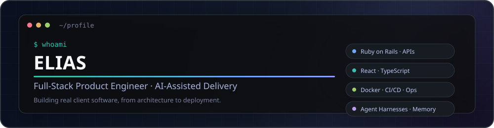
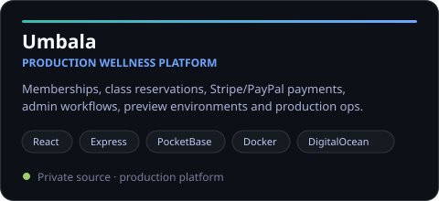
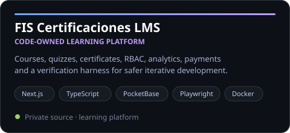

  

  

## Hey, I'm Elías 👋

I'm a **full-stack software engineer** who enjoys turning ideas and messy requirements into software that people actually use. I work across the whole process — from figuring out how a product should work to building, testing, deploying, and keeping it running.

These days, **AI coding agents are part of my workflow**. I give them context and direction, then review and validate the results. For me, the goal isn't generating more code — it's shipping better software.

**[🌐 Portfolio](https://eliasecasta.github.io/Portfolio/)** · **[💼 LinkedIn](https://www.linkedin.com/in/eliasecasta/)**

### Things I've built for real clients

  
  

**[Umbala](https://umbala.com.mx/)** — A wellness platform with class bookings, credits, payments, and admin tools. Built with **React, Express, and PocketBase**, and deployed on DigitalOcean.

**[FIS Certificaciones](https://fiscertificaciones.com.mx/)** — A custom learning platform replacing a WordPress-based LMS, with courses, quizzes, certificates, and student/admin workflows. Built with **Next.js, TypeScript, and PocketBase**.

*The client codebases are private, but the live websites are linked above.*

### What I work with

**React · Next.js · TypeScript · Node.js · Ruby on Rails · APIs · PocketBase · SQL · Docker · Playwright · GitHub Actions**

I previously worked in code review, mentoring, and remote technical support at **Microverse**, and developed software during an internship at **Safran** in France.

I'm open to **remote software engineering and product engineering roles** with US, European, and globally distributed teams. If you'd like to chat, find me on **[LinkedIn](https://www.linkedin.com/in/eliasecasta/)**.

### A little activity from my corner of GitHub 🐍

<picture>
  <source media="(prefers-color-scheme: dark)" srcset="./profile/contribution-snake-dark.svg" />
  <source media="(prefers-color-scheme: light)" srcset="./profile/contribution-snake.svg" />
  
</picture>
